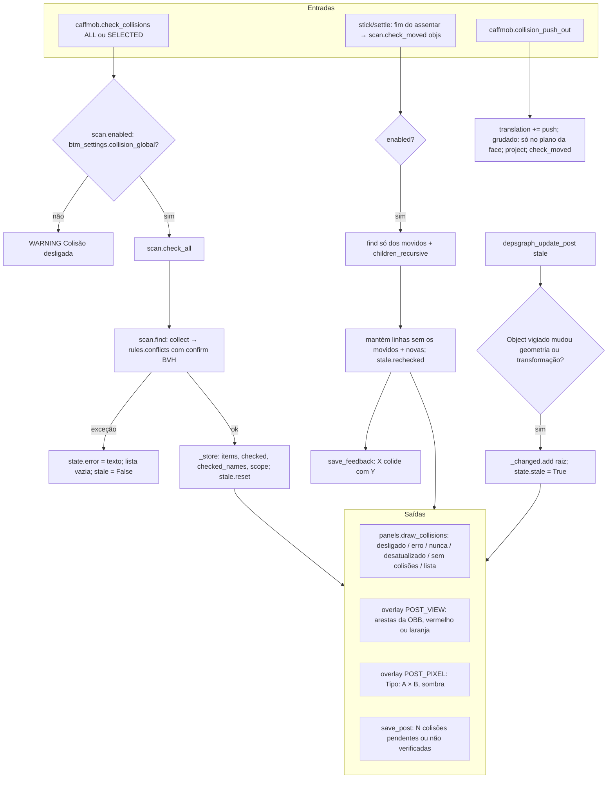

# Fluxograma: módulo `collision`

Verificação de colisão de corpo (feature 004, I2): o item fica onde foi solto; o sistema avisa, destaca e oferece afastar.

Camadas: `obb` e `rules` são puros (testáveis sem Blender); `scan` traduz a cena em `Item`s e confirma pares finos pela
malha (`BVHTree.overlap`); `props` guarda o resultado em `WindowManager.btm_collision`, nunca no arquivo.
