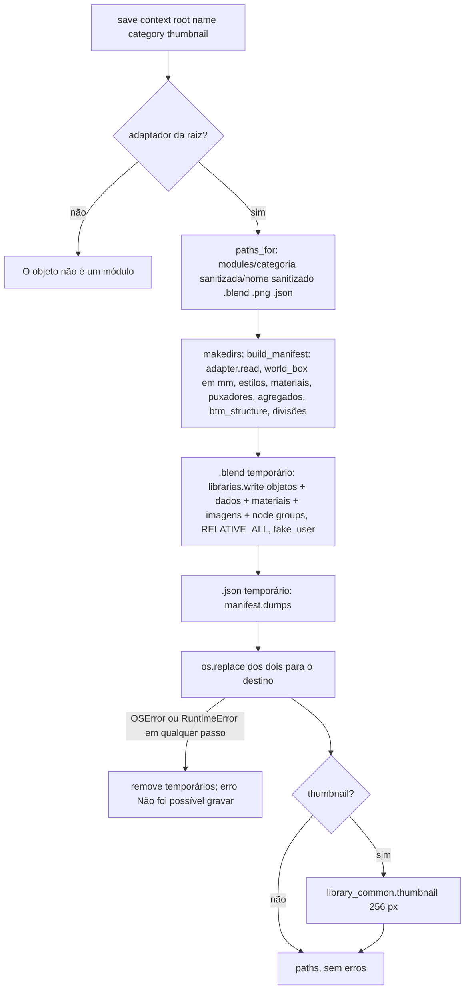
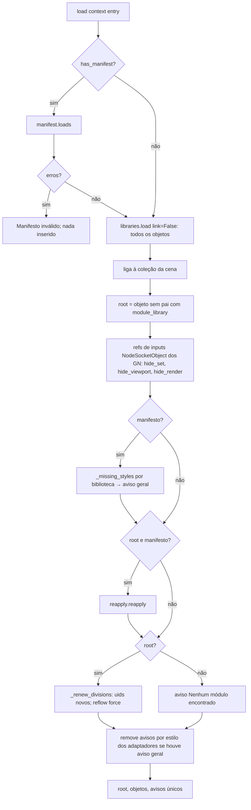
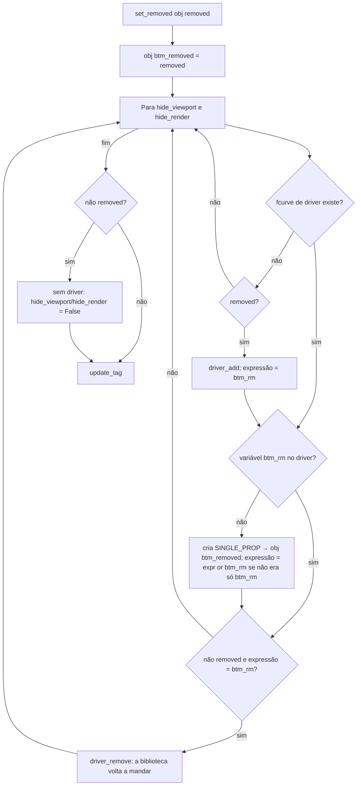

# Fluxograma: `library_io.save`, `library_io.load` e `common.set_removed` (customize)

Biblioteca de módulos do usuário (D-10, D-11, RF-07 a RF-10) e remoção de chapa por driver (006, D-07).

Gravação atômica: os dois arquivos só aparecem no destino depois de completos; falha no meio não deixa parciais.
A remoção por driver soma-se ao esconder que a biblioteca já dirige, em vez de substituí-lo.
