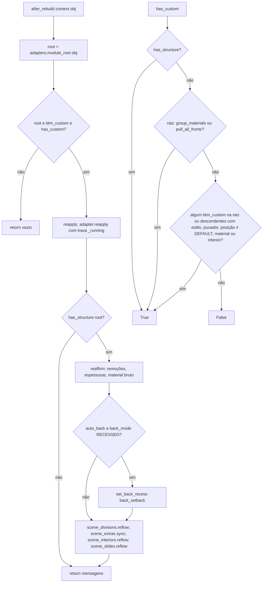
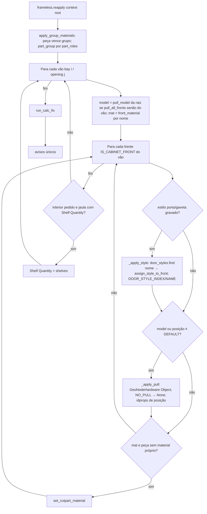
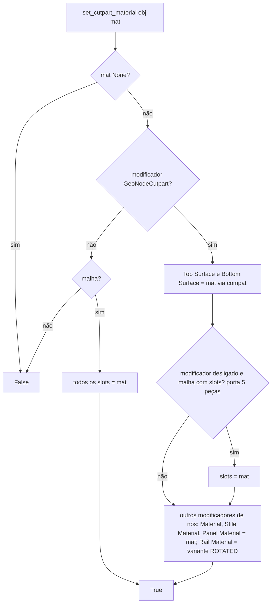

# Fluxograma: `reapply.after_rebuild`, `frameless.reapply` e `common.set_cutpart_material` (customize)

Gancho pós-reconstrução (D-03, D-04): a biblioteca recria frentes e materiais; o adaptador relê `btm_custom` e reaplica.

`_running` evita reentrância quando a reaplicação dispara novo recálculo da biblioteca, que chamaria `after_rebuild`
de novo. Estilo por nome resolve o índice só no momento de aplicar (RN-06): remover um estilo não desloca os demais.
