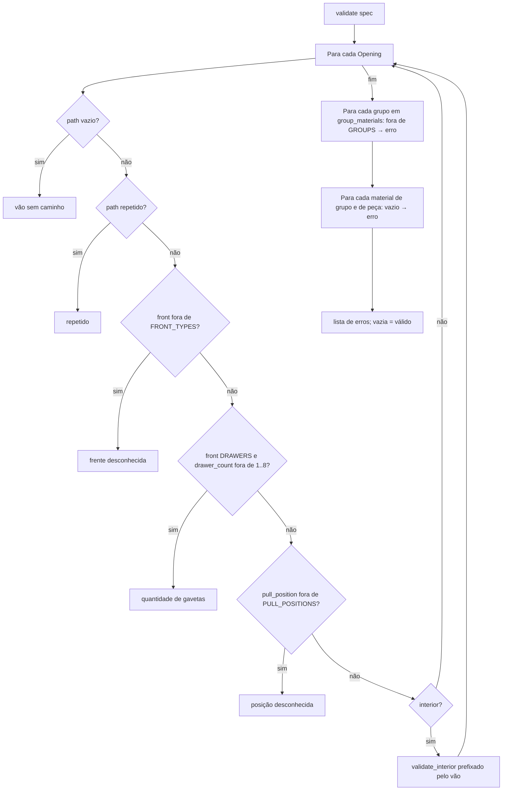
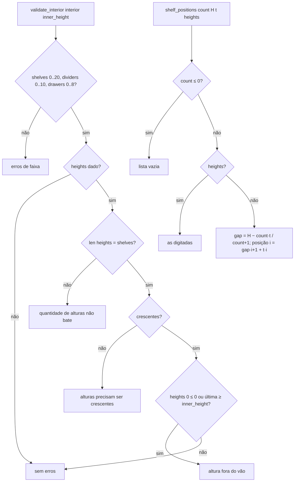

# Fluxograma: `spec.validate`, `spec.validate_interior`, `spec.shelf_positions` e `manifest.validate` (customize)

Validação pura, sem Blender (RN-01 a RN-06; contrato 1.1.0).





```mermaid
flowchart TD
    A[manifest.validate data] --> B{dict?} -- não --> E0[não é objeto JSON]
    B -- sim --> C{format = caffmob_draw.user-module?} -- não --> E1[formato desconhecido]
    C -- sim --> D{major de schema_version ≤ 1?} -- não --> E2[versão não suportada]
    D -- sim --> F{library em LIBRARIES?} -- não --> E3[biblioteca desconhecida]
    F -- sim --> G{name e root_object não vazios?} -- não --> E4[nome vazio / raiz não informada]
    G -- sim --> H{algum erro até aqui?}
    H -- sim --> R[devolve erros]
    H -- não --> I[spec.validate from_dict spec]
    I --> J[_validate_structure: papel em ROLES, modo em MODES, space ^s\d+ .a|.b *$, orientação, medidas ≥ 0]
    J --> R
```

Leitor 1.0 abre arquivos 1.1.0 (mesmo major) e ignora `structure` e `divisions`; `loads` devolve `(dados, None, erros)`
em vez de levantar exceção.
