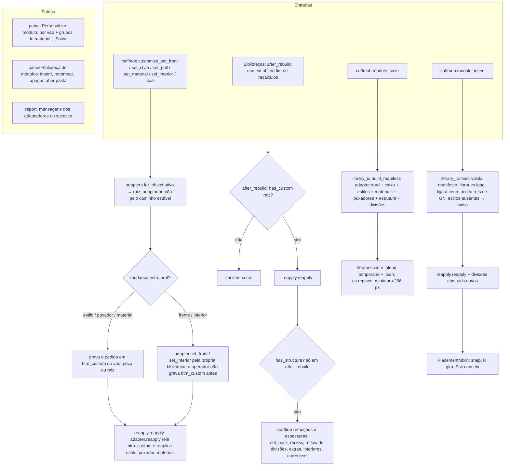

# Fluxograma: módulo `customize`

Personalização por instância e biblioteca de módulos do usuário (feature 003, bloco A; 006 e 008 estendem).

Núcleos puros: `spec.py` (o que mudou na instância, validação, serialização) e `manifest.py` (contrato
`caffmob_draw.user-module` 1.1.0). Um adaptador por biblioteca (`frameless`, `face_frame`, `closets`, `btm`) traduz
o `Spec` para os mecanismos de cada uma; `common.py` concentra materiais, drivers de remoção e espaços internos.

_(Revisão cruzada 2026-10-10: ops_customize.py:92-99 chama `adapter.set_front` sem gravar `btm_custom` antes (só os operadores de estilo, puxador e material gravam); `reapply.reapply` (reapply.py:46-55) não testa `has_structure` — o reafirmar/reflow fica em `after_rebuild` (reapply.py:58-80))_
