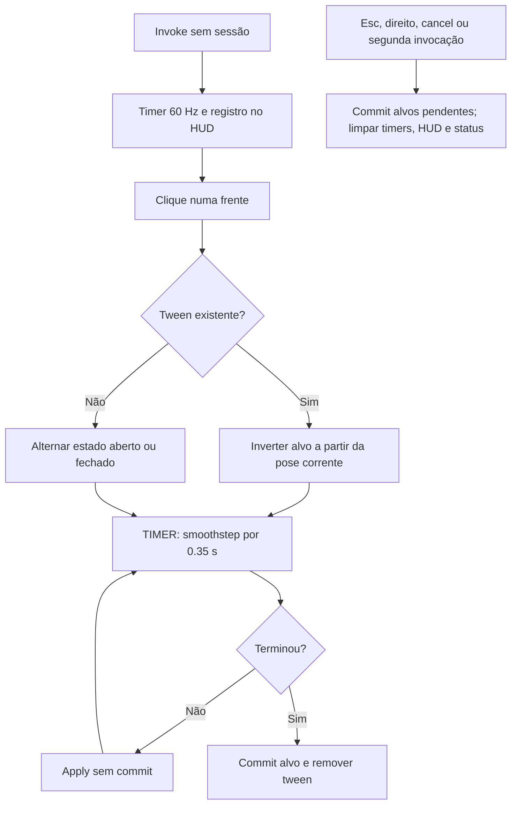

# Tween e saída do modo de inspeção

🟢 **CONFIRMADO** — inspection/ops_inspect.py:142–251. Extração: 2026-10-10.

Esc sai do modo, mas não desfaz abertura. Unregister não chama _finish da sessão ativa.
