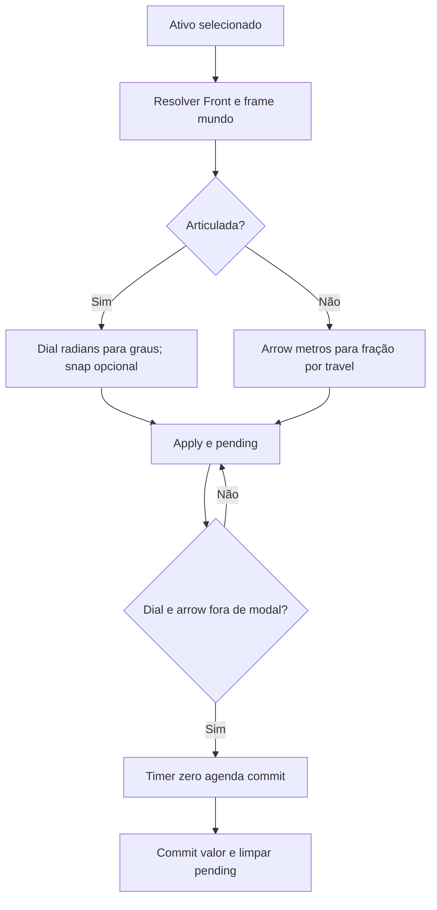

# Arraste do gizmo e commit diferido

🟢 **CONFIRMADO** — inspection/gizmo.py:23–166. Extração: 2026-10-10.

AggregateLeafFront deslizante não implementa travel, embora arrow o invoque; confirmar efeito em runtime. Pending é global, não por janela.
