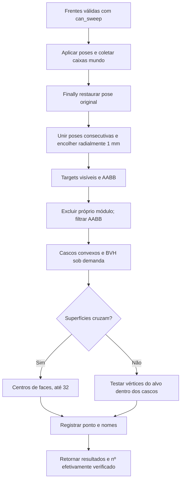

# Envelope e detecção de interferência

🟢 **CONFIRMADO** — inspection/interference.py:58–219. Extração: 2026-10-10.

Sem teste de choque com peças do mesmo módulo. Amostragem angular e caixas são aproximações, não simulação mecânica completa.
