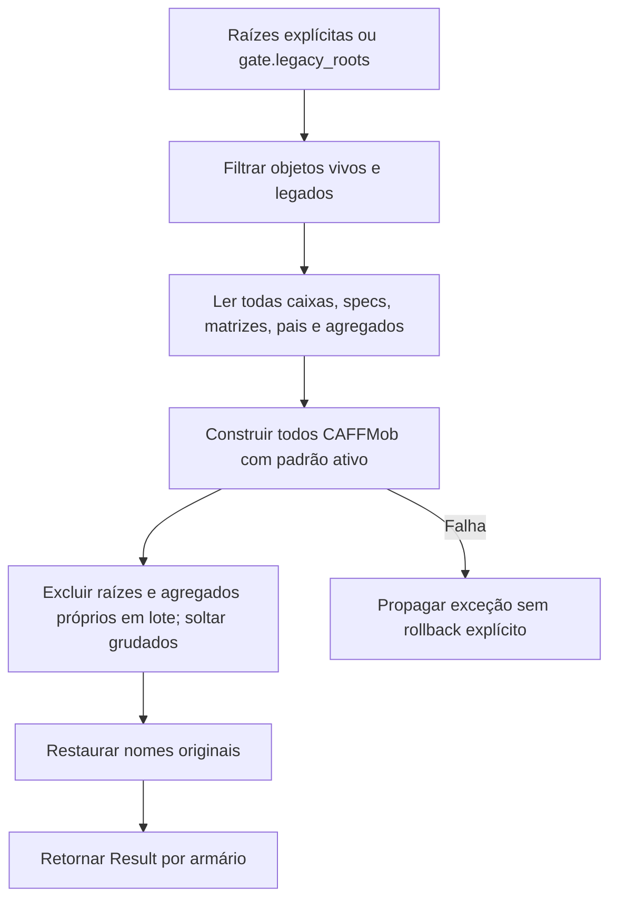

# Conversão em lote da cena

🟢 **CONFIRMADO** — legacy/convert.py:77–145. Extração: 2026-10-10.

🟢 A estrutura evita exclusão um a um. Falha durante construção pode deixar módulos novos parciais; o operador declara UNDO, mas runtime não verificado.
