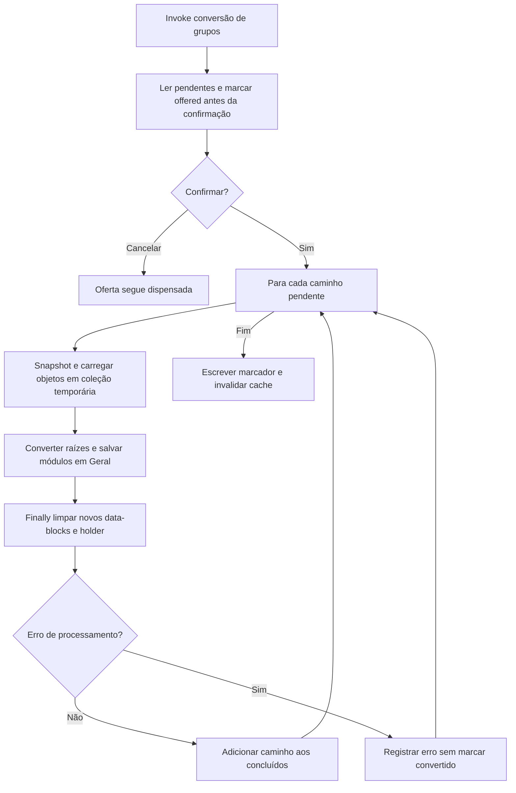

# Conversão de grupos salvos e marcador

🟢 **CONFIRMADO** — legacy/groups.py:91–154; ops.py:85–103. Extração: 2026-10-10.

Erros retornados pelo save só entram no relatório e não impedem marcação do grupo. Arquivos de origem são preservados; reexecução usa caminho, sem verificar conteúdo alterado.
