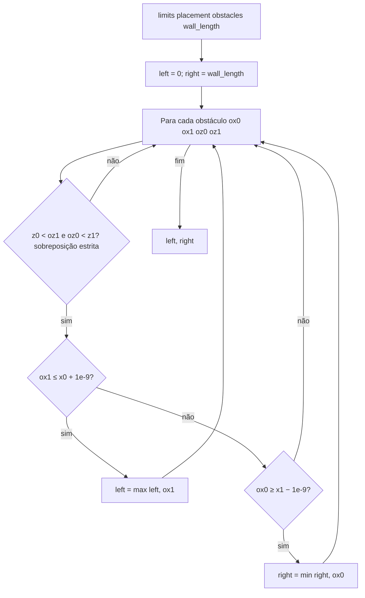
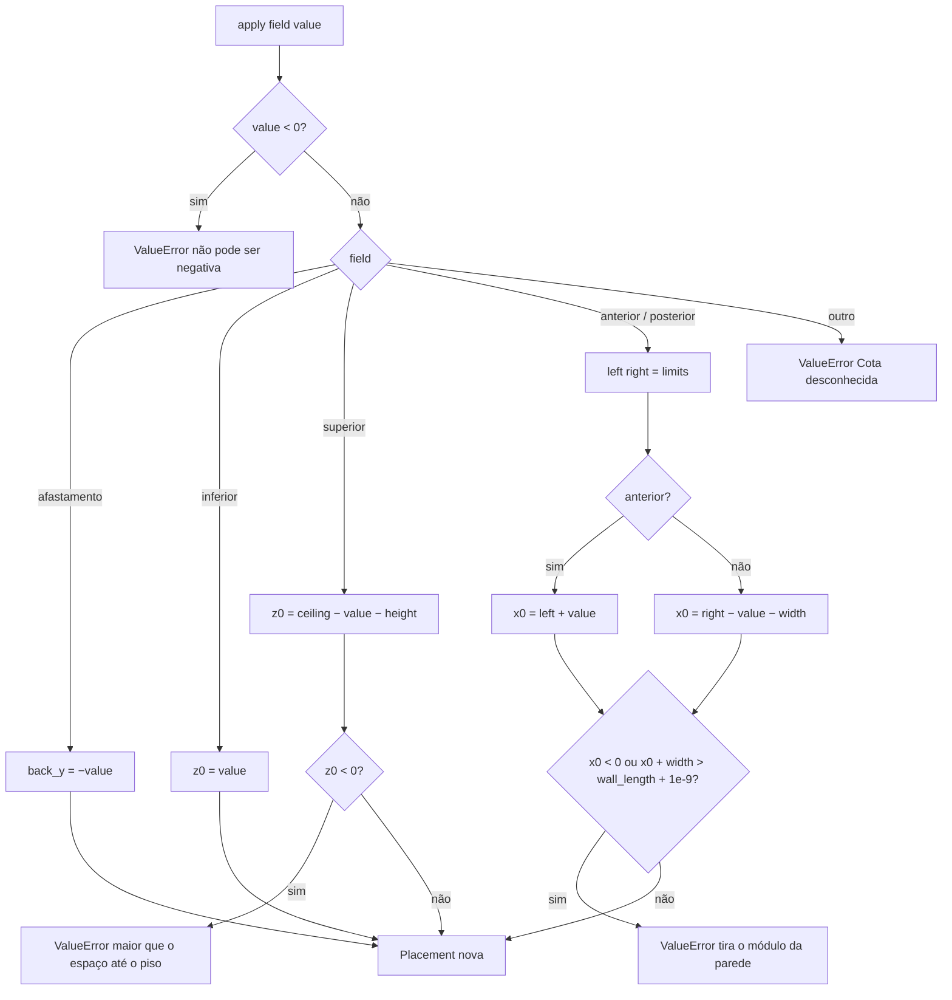
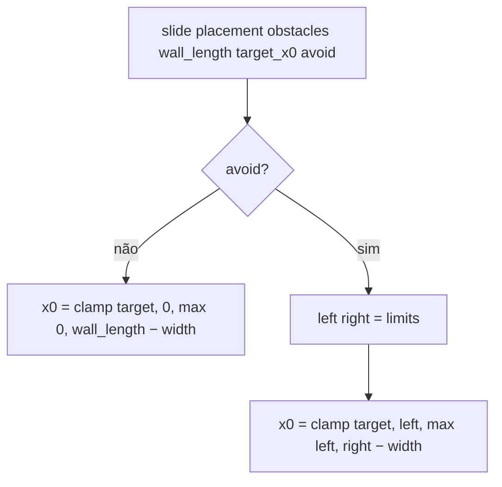

# Fluxograma: `cotas.limits`, `cotas.apply` e `cotas.slide` (measure/cotas.py)

Limites laterais por obstáculos na mesma faixa de altura e a cota digitada que move o módulo (RN-04, RF-34).

As dimensões (`width`, `height`) nunca mudam: a cota só desloca `x0`, `z0` ou `back_y`. Obstáculos que cruzam o
módulo em X são ignorados pelos limites (o módulo já está sobreposto; nada o bloqueia).
