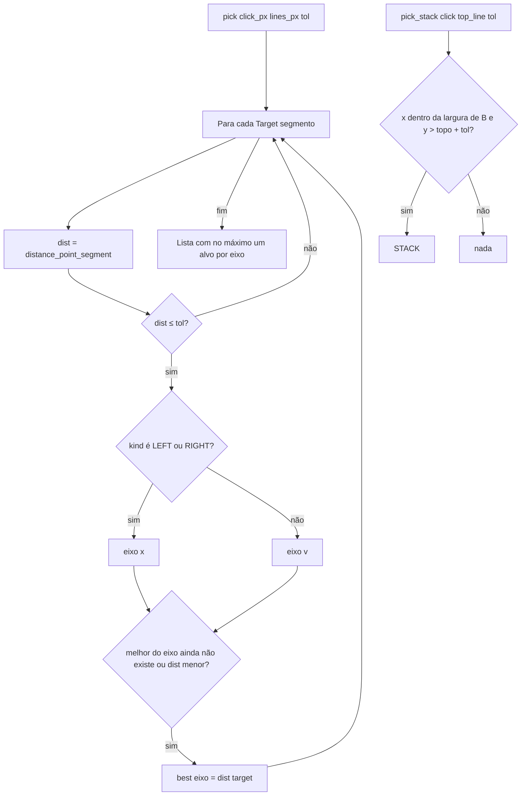

# Fluxograma: `align.delta_for`, `combine` e `pick` (move_over/align.py)

Alvos no referencial de B e escolha pelo clique.

```mermaid
flowchart TD
    A[delta_for target box_a box_b] --> B{kind}
    B -- LEFT --> C[dx = bx0 − ax1]
    B -- RIGHT --> D[dx = bx1 − ax0]
    B -- DEPTH f --> E[dy = by0 + f·(by1 − by0) − ay0: frente de A na linha]
    B -- WALL_FACE --> F[dy = by0 − ay1: fundo de A na face da parede]
    B -- HEIGHT f --> G[dz = bz0 + f·(bz1 − bz0) − az0: base de A na linha]
    B -- STACK --> H[dz = bz1 − az0: A em cima de B]
    B -- outro --> I[ValueError Alvo desconhecido]
    J[combine targets] --> K[Para cada alvo: delta_for]
    K --> L[Para cada eixo com valor ≠ 0: total eixo = valor; o último vence]
    L --> M[tupla dx dy dz]
```



`top_view_lines(box_b, wall=True)` devolve só os lados e a linha da face da parede (sem frações); `pick` sobre ela só
pode combinar lado + `WALL_FACE`. Nas vistas, `_hits` tenta `pick_stack` apenas quando `pick` não achou alvo na frontal.
