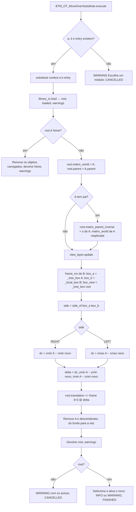

# Fluxograma: `ops_substitute.substitute` (move_over/ops_substitute.py)

Troca A por um módulo da biblioteca do usuário no mesmo lugar, com a rotação de A e o mesmo canto de referência.

`_tree_box` usa as malhas visíveis do grupo (fora `WIRE`/`BOUNDS`); sem nenhuma, a caixa da raiz. O `module` Enum é
preenchido a cada leitura por `library_io.list_modules()` (id = caminho do `.blend`), e `_ITEMS` global mantém as
strings vivas para o Blender.
