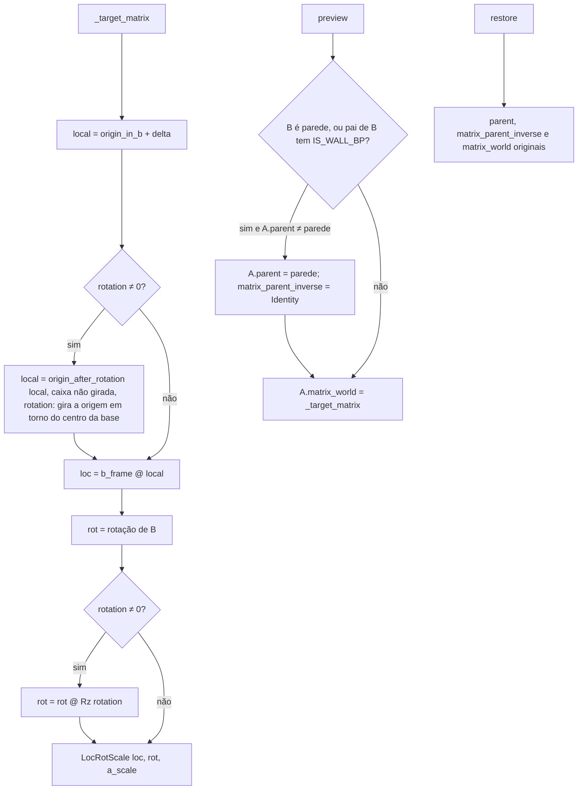
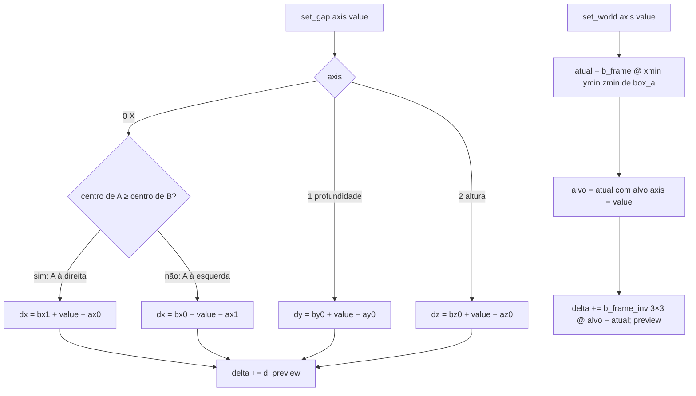

# Fluxograma: `MoveOver._target_matrix`, `preview` e `set_gap` (move_over/scene.py)

Posição de A no mundo a partir de `delta` e `rotation` no referencial de B.

`box_a()` = caixa local de A posta em `origin_in_b + delta` e, com rotação, envolvida por `rotated_box` (caixa
alinhada da planta girada pelo centro da base, Z inalterado). `gaps()` e `world_min()` são só exibição: trocar
Relativa/Absoluta não move nada.
