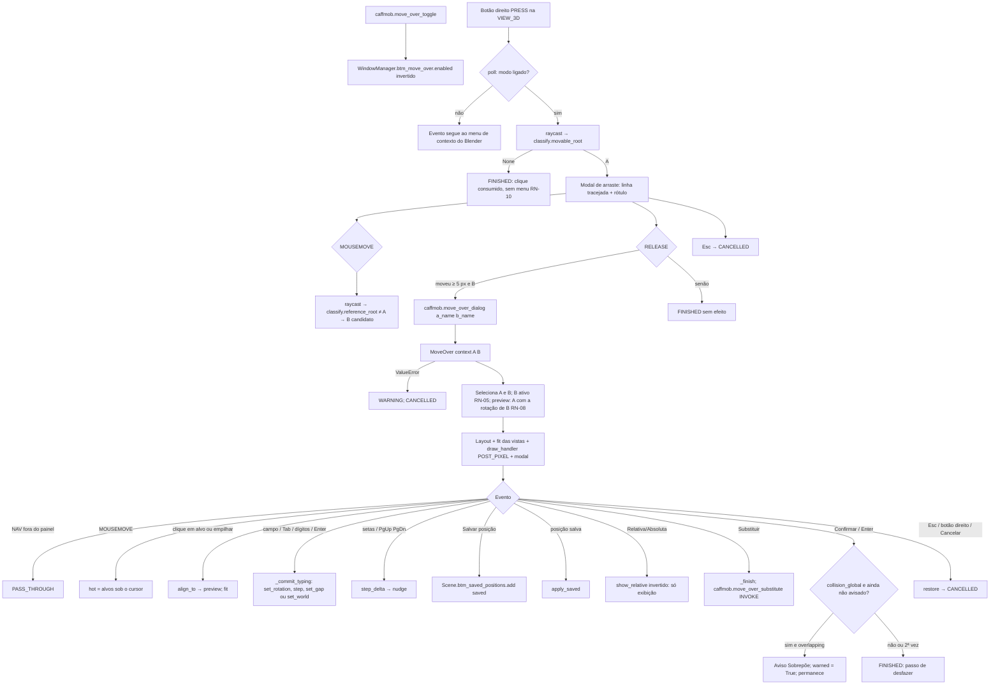
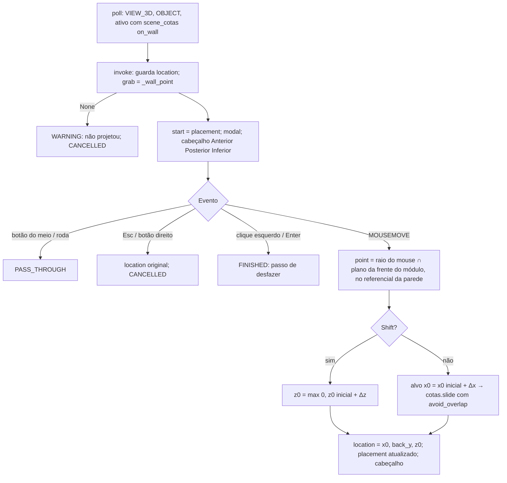
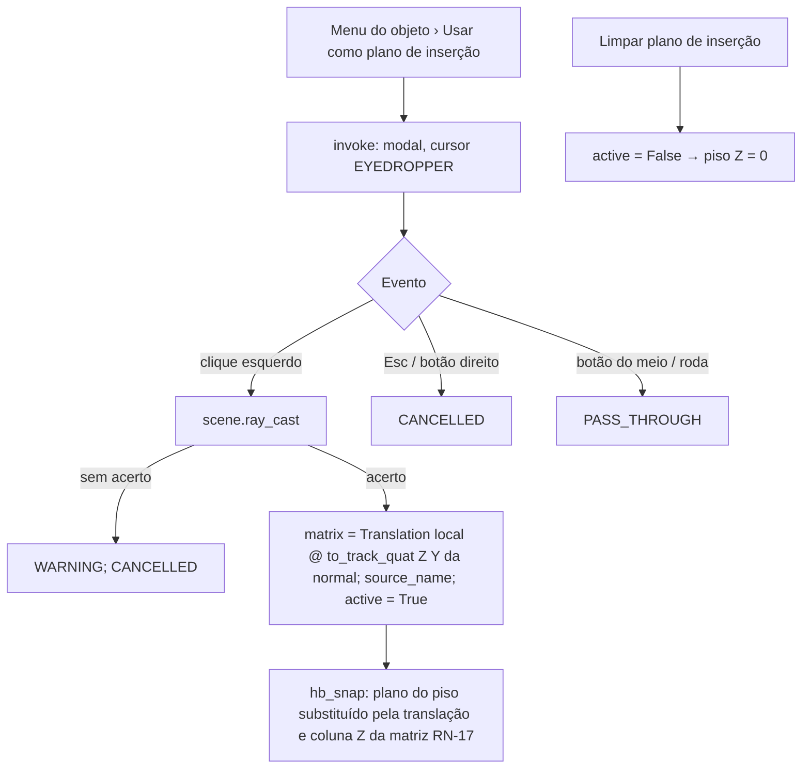

# Fluxograma do Módulo: move_over

"Mover Sobre" (`caffmob_draw/move_over/`), nível **Detalhado**. Re-extração 2026-10 (Fase 2c).

## 1. Modo, arraste e janela

## 2. Mover na Parede (`caffmob.move_on_wall`)

## 3. Plano de inserção

