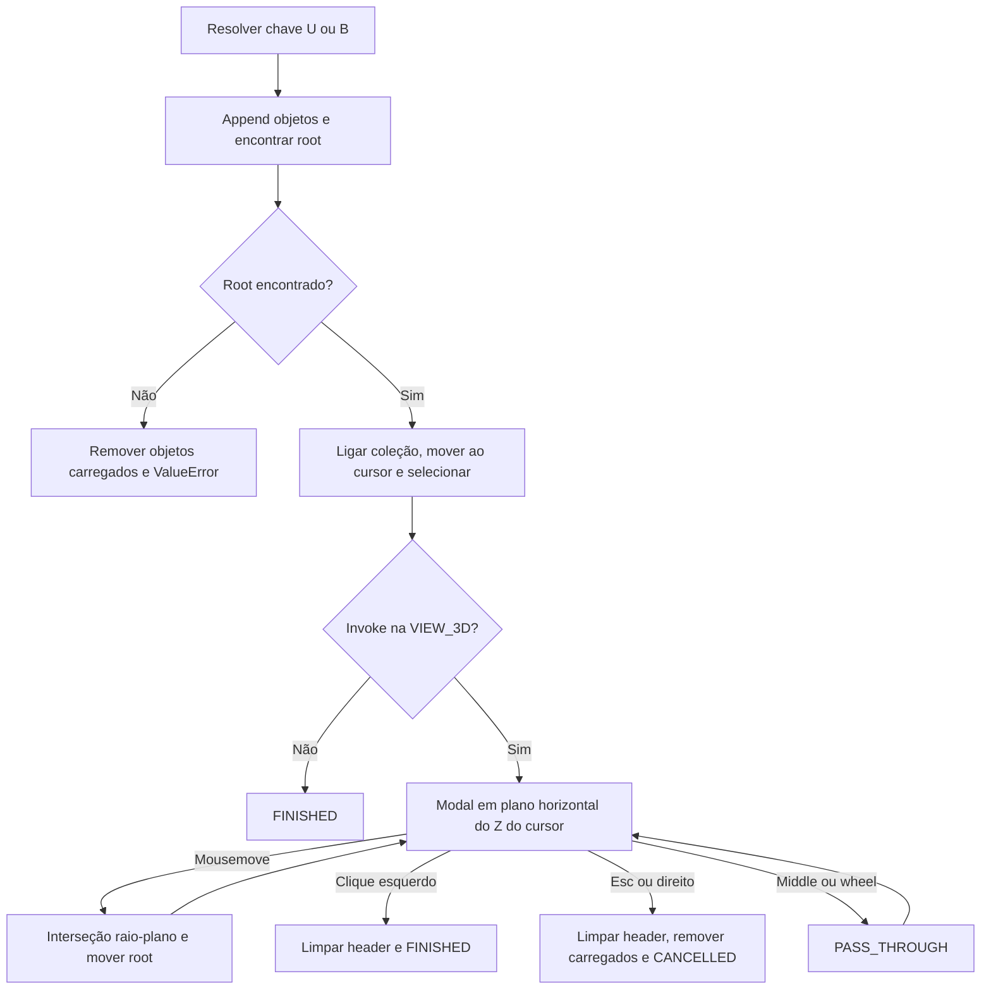

# Append e posicionamento modal

🟢 **CONFIRMADO** — object_library/item_io.py:124–148; ops.py:48–131. Extração: 2026-10-10.

🔴 cancel externo só limpa header; sem remoção dos objetos nesse método. Referências RNA diretas durante modal exigem validação com undo.
