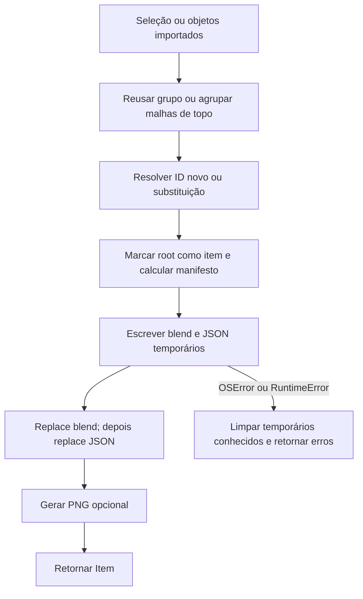

# Preparação e gravação de item

🟢 **CONFIRMADO** — object_library/item_io.py:57–121; ops.py:211–239. Extração: 2026-10-10.

🟢 Não há transação conjunta dos arquivos; falha do segundo replace pode deixar par parcialmente atualizado. Marcas na raiz não são revertidas pela rotina.
