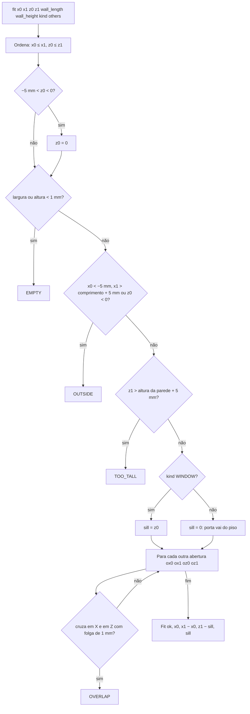

# Fluxograma: `region_core.fit` (openings/region_core.py)

Encaixe da porta ou janela na região marcada (D-11, RN-11, RN-12).

Largura e altura são exatamente as da região. Encostar (borda a borda) ou ficar acima de outra abertura não bloqueia.
