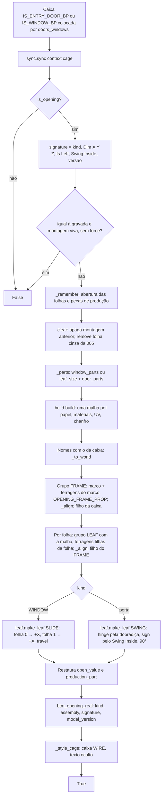
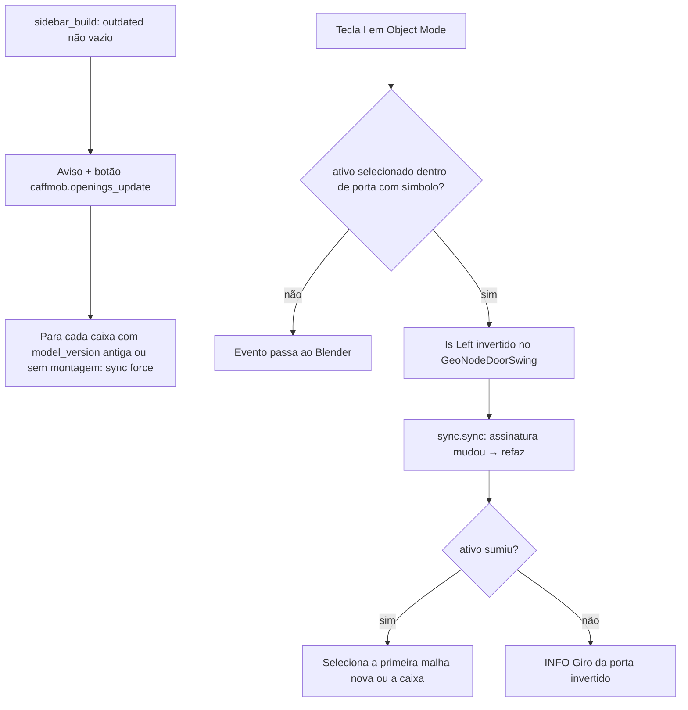
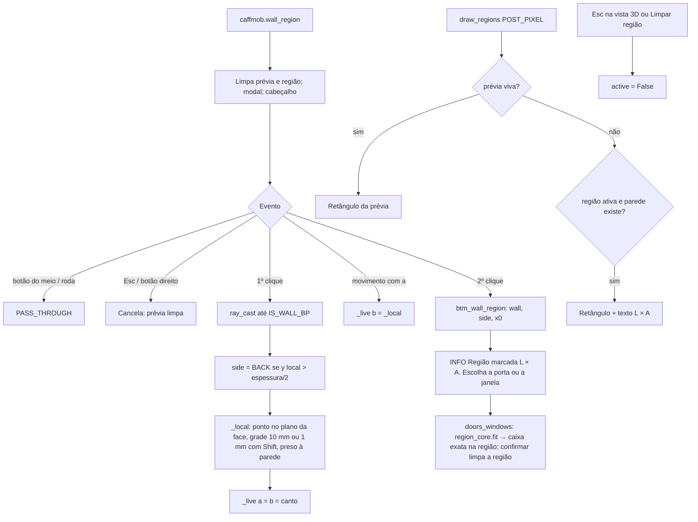

# Fluxograma do Módulo: openings

Porta e janela reais na parede (`caffmob_draw/openings/`), nível **Detalhado**. Re-extração 2026-10 (Fase 2c).

## 1. Da caixa à porta real

## 2. Atualizar e tecla I

## 3. Região marcada na parede (feature 011)

