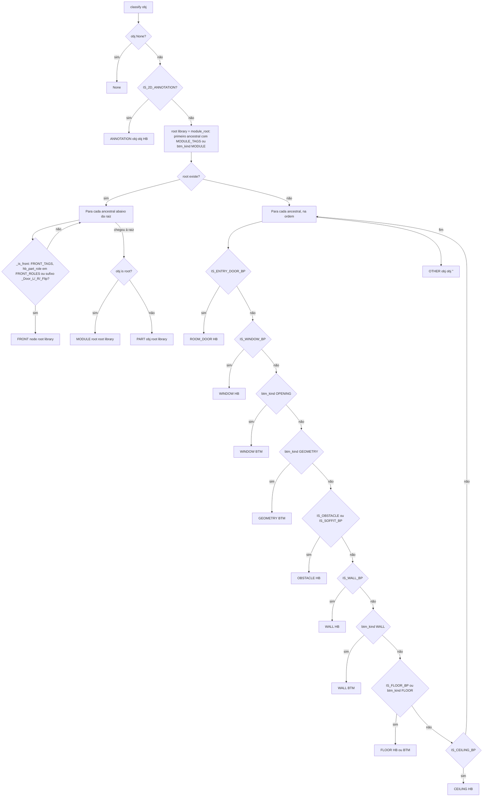
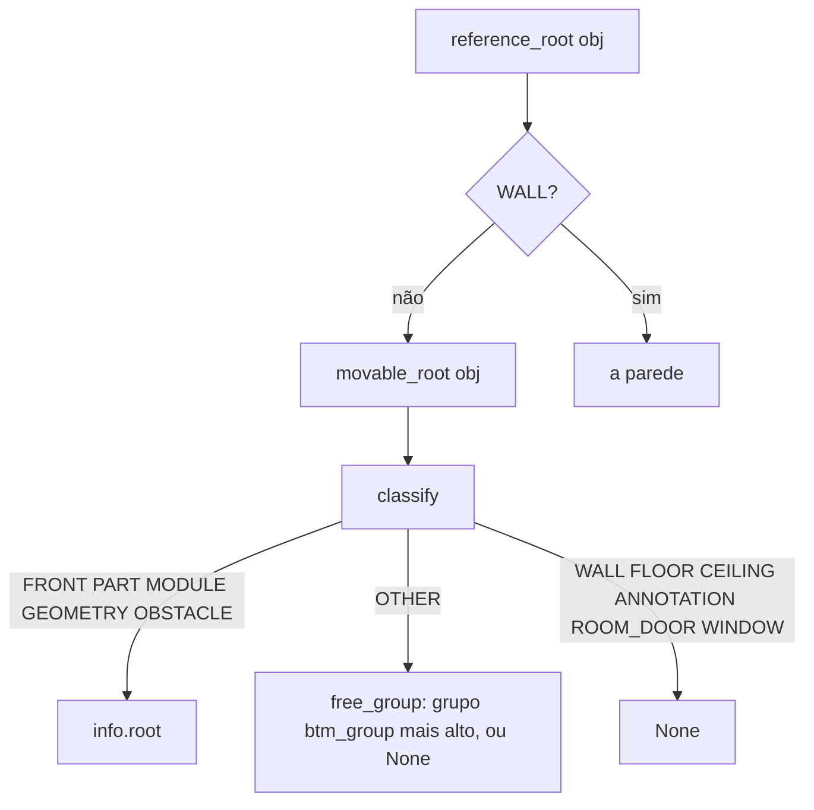

# Fluxograma: `classify.classify` e raízes do Mover Sobre (selection/classify.py)

Precedência RN-01: frente e peça antes do módulo, módulo antes da parede.

`btm_kind(node)` só devolve `btm_plane.object_kind` quando `is_property_set('object_kind')`: o enum tem padrão `WALL`
em todo objeto (BUG-20261007-TBY3).

