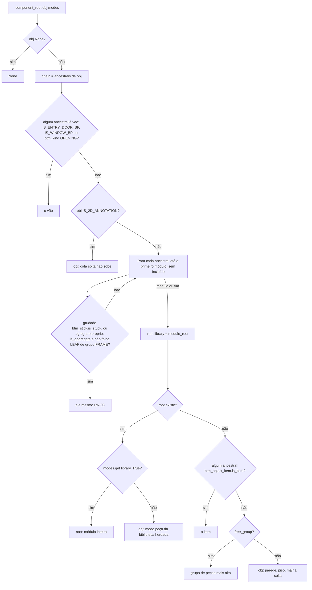
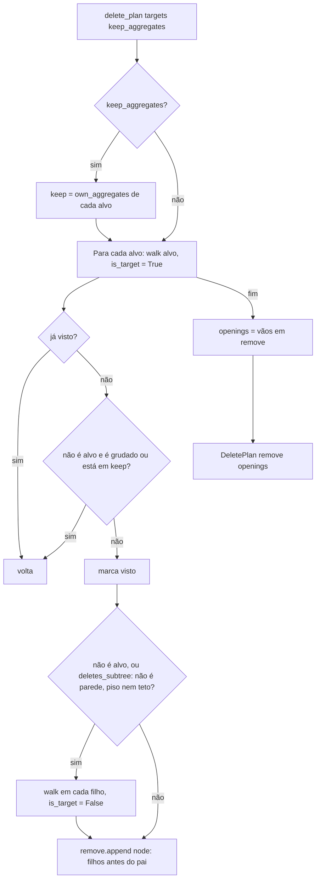

# Fluxograma: `component.component_root` e `delete_plan` (selection/component.py)

Raiz do componente pela precedência D-01 e plano de exclusão em profundidade (D-05).

`own_aggregates(target)`: desce pelos filhos (sem entrar em vãos nem partir de grupo `FRAME`) e recolhe agregados que
são a própria raiz de componente; a folha de porta, janela ou esquadria é peça delas e não entra.
