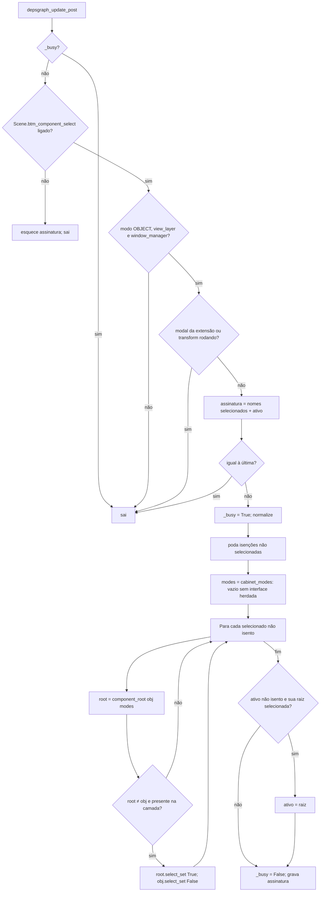
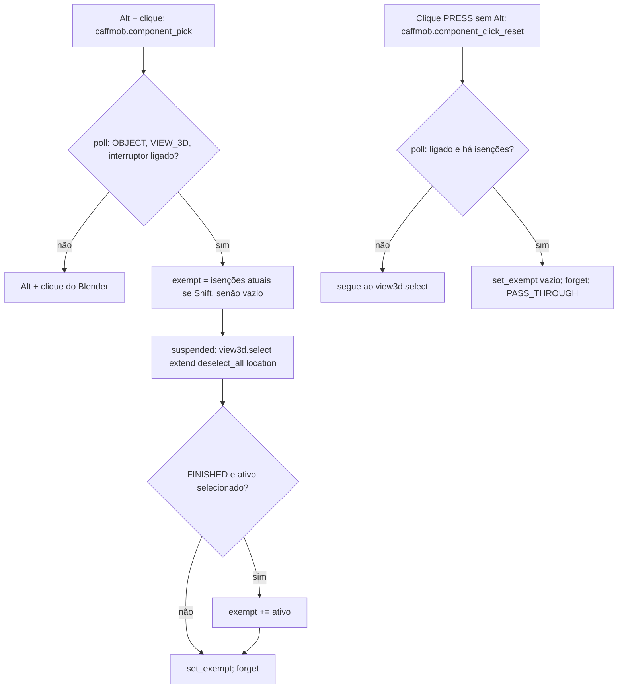
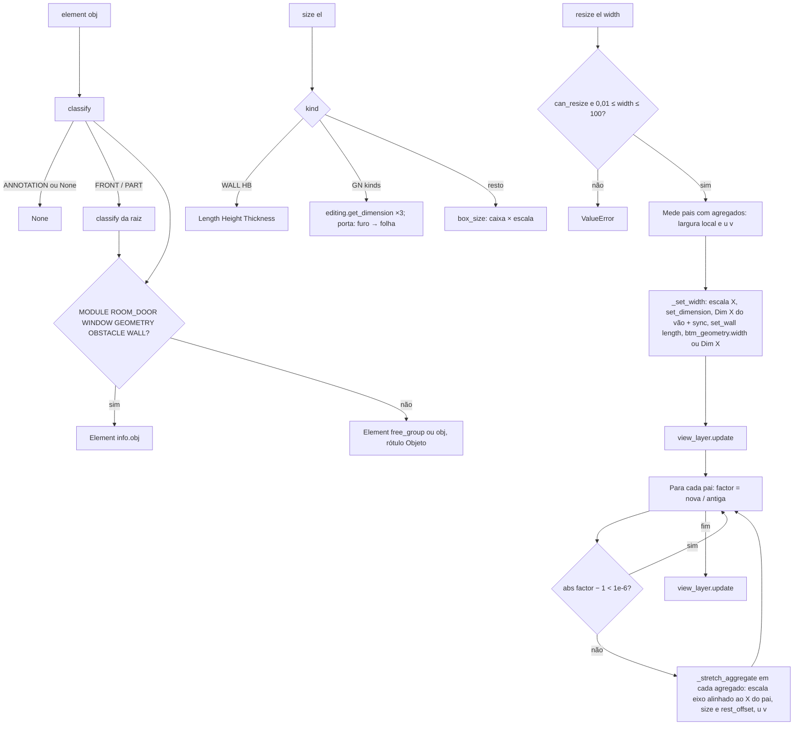

# Fluxograma do Módulo: selection

Classificação, seleção por componente, dimensões e Redimensionar (`caffmob_draw/selection/`), nível **Detalhado**.
Re-extração 2026-10 (Fase 2c).

## 1. Normalizador da seleção por componente

## 2. Alt + clique e reset

## 3. Dimensões e Redimensionar

