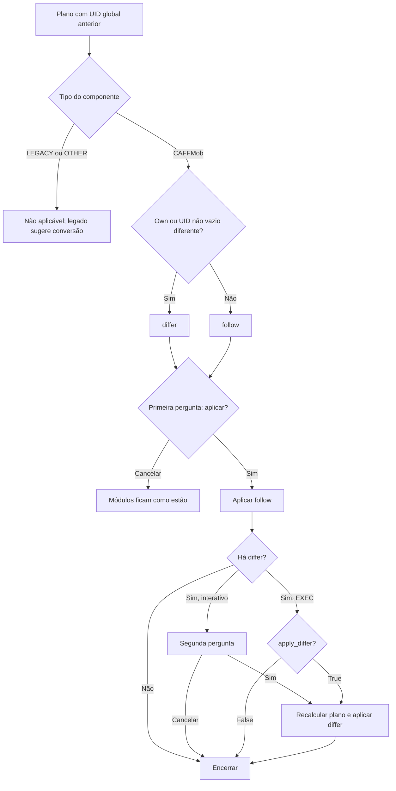

# Seleção dos módulos nas duas perguntas

🟢 **CONFIRMADO** — fontes: `standards/apply_core.py:24–42; sync.py:206–228; operators/ops_standards.py:491–590`. Extração: 2026-10-10.

A definição e os destinos de cena já foram gravados antes das perguntas. Cancelar a segunda não reverte follow. `targets` é puro e testado; operadores usam diretamente as listas do plano.
