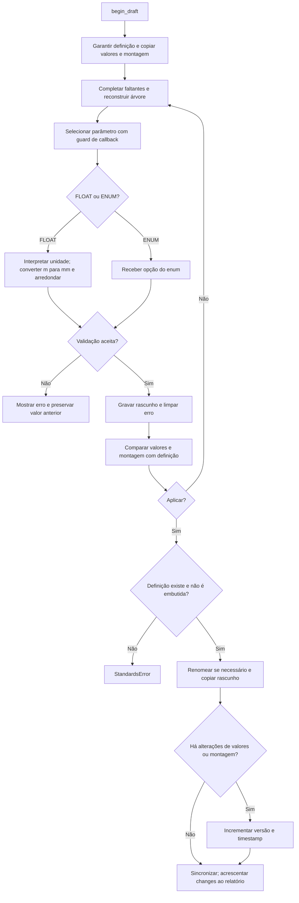

# Rascunho e aplicação pelo Configurador

🟢 **CONFIRMADO** — fontes: `standards/api.py:241–319, 418–478`. Extração: 2026-10-10.

A cópia no apply não revalida a coleção inteira. Renomeação isolada não incrementa versão. A validação numérica atual aceita NaN; não inferir proteção de finitude.
