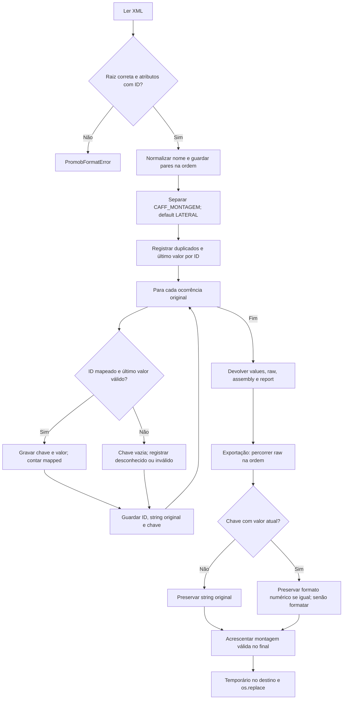

# Mapeamento e reexportação do DIMENSIONEXPORT

🟢 **CONFIRMADO** — fontes: `standards/io_promob.py:32–190`. Extração: 2026-10-10.

Mapped conta ocorrências, não chaves distintas. A reexportação com raw não acrescenta campos ausentes do arquivo original. A raiz/DEFINITION é regenerada; só ordem e strings de atributos são preservadas. 🔴 Integração no aplicativo Promob não verificada.
