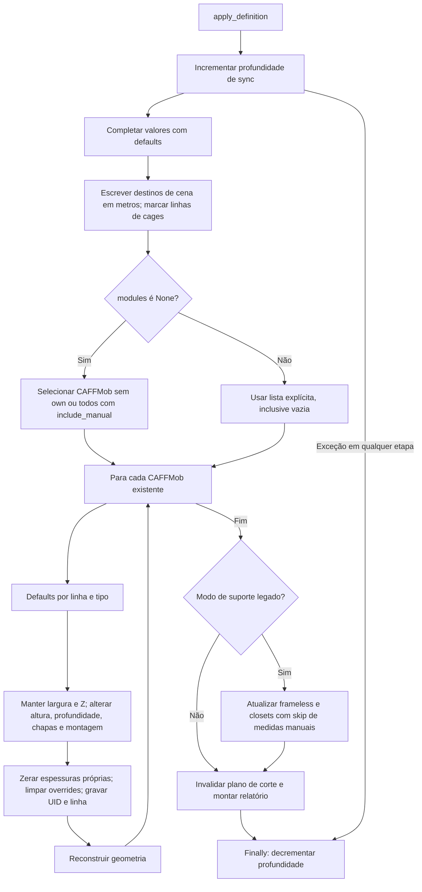

# Propagação da definição para cena e móveis

🟢 **CONFIRMADO** — fontes: `standards/sync.py:169–176, 231–291`. Extração: 2026-10-10.

`modules=None` não compara UID anterior; a seleção do diálogo usa outra regra. Lista vazia ainda escreve destinos de cena e pode atualizar legado no suporte. Erros não desfazem as escritas anteriores; o finally restaura apenas a profundidade.
