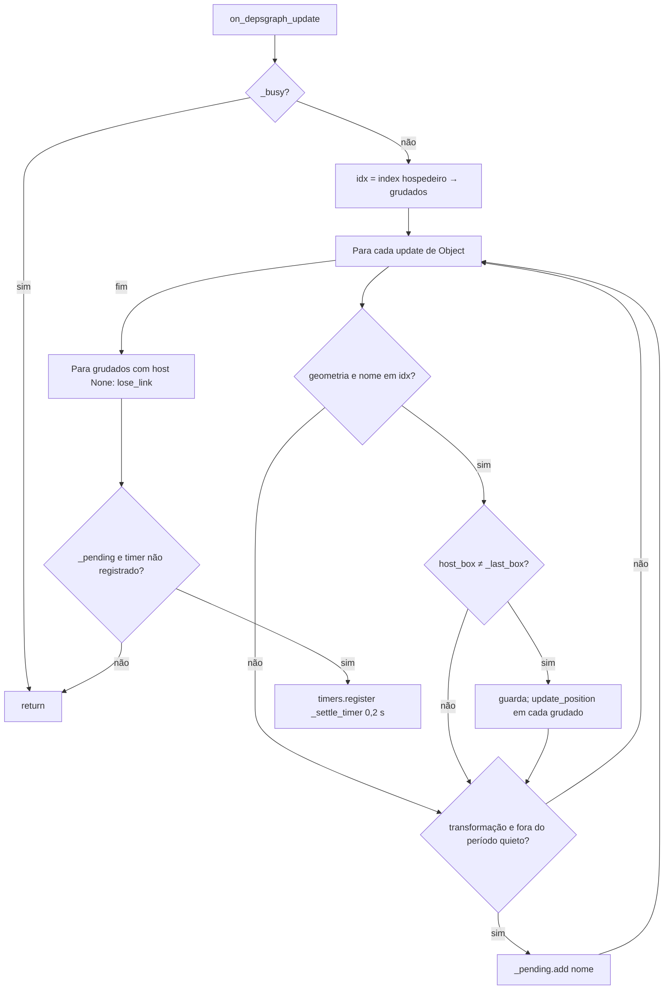
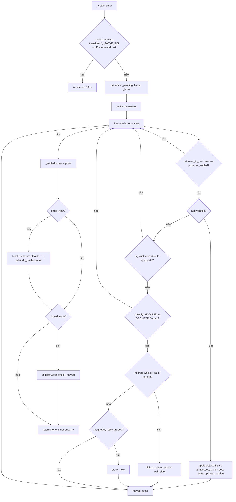
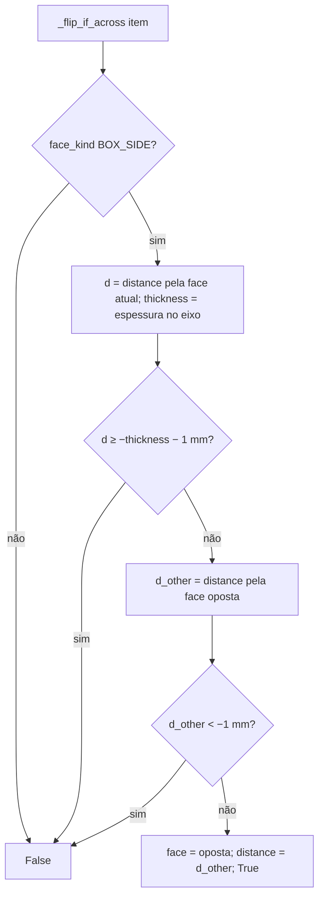

# Fluxograma: `apply.on_depsgraph_update`, `_settle_timer` e `settle.run` (stick)

Manter o item na face sem brigar com o arraste do usuário (D-04, D-06, D-16, RF-12, RF-13, RF-19, RF-23).

`on_load_or_undo` (`load_post`, `undo_post`, `redo_post`) abre um período quieto de 0,6 s em que transformações não
contam como gesto, e limpa índice, `_last_box` e pendentes.
