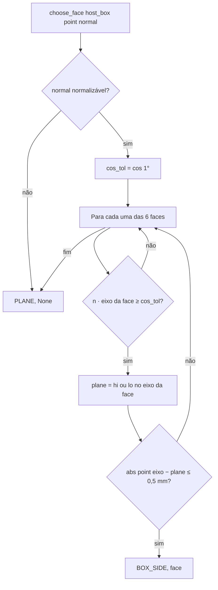
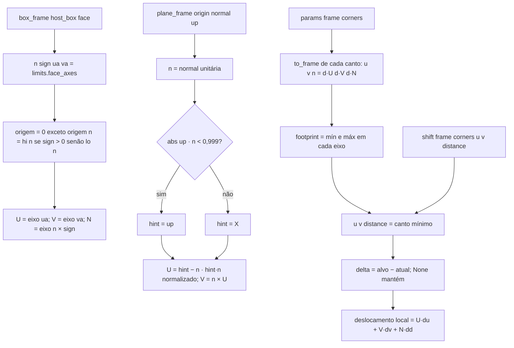
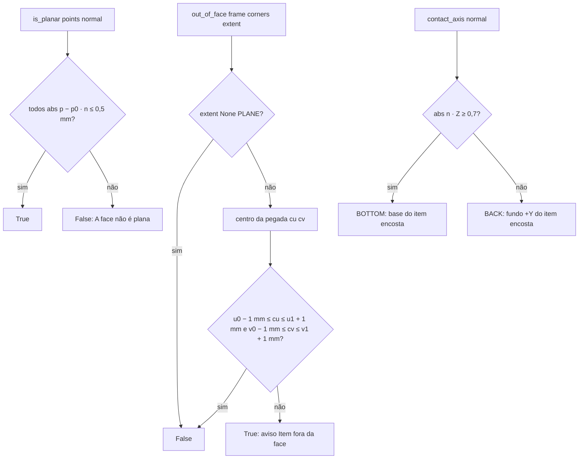

# Fluxograma: `frame.choose_face`, `frame.params` / `shift` e `frame.out_of_face` (stick)

Núcleo puro do grudar (D-01, D-02, RN-05, RN-06, RN-08a).

`u`/`v` partem da origem local do hospedeiro, que não se move ao redimensionar: um aéreo grudado atrás da parede
continua encostado quando a espessura muda (`distance` mantido, `box_frame` recalculado).
