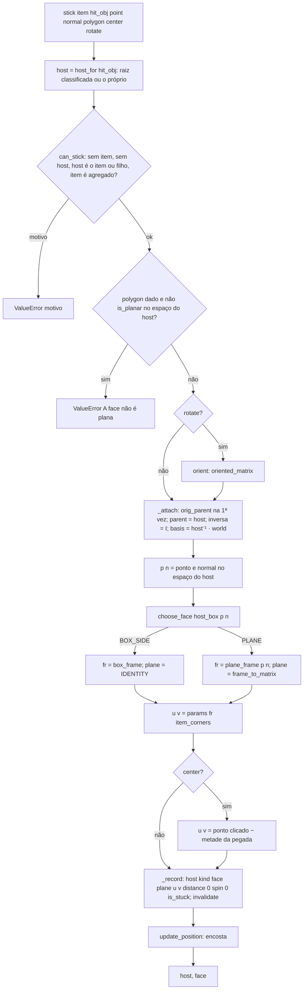
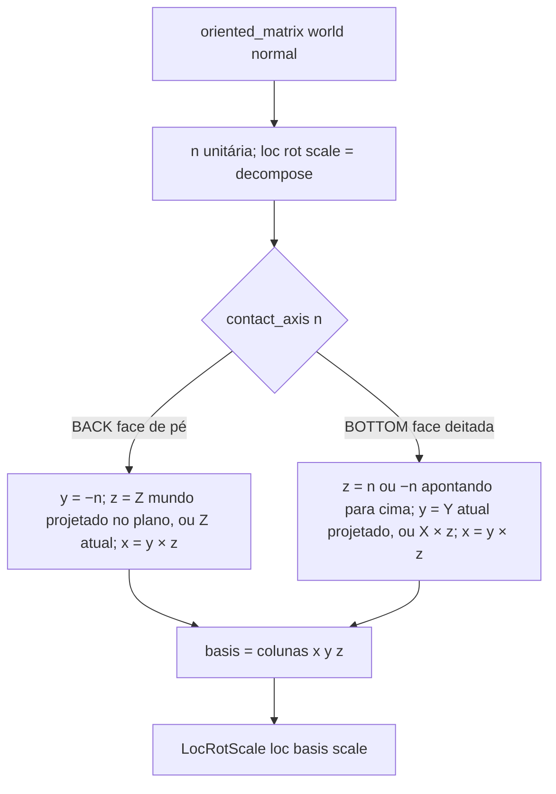
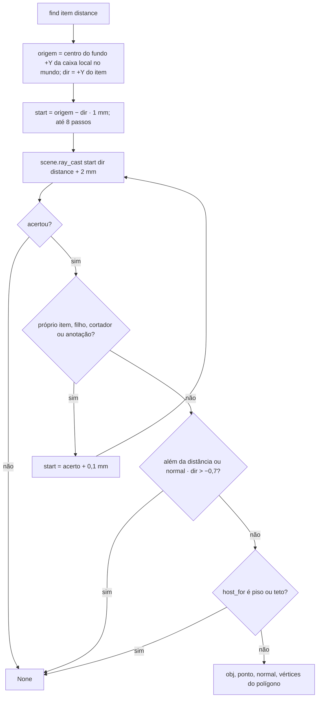

# Fluxograma: `link.stick`, `link.oriented_matrix` e `magnet.find` (stick)

Grudar numa face (D-03, D-05, RN-05) e ímã (D-06, RN-10a).

`try_stick` chama `stick(center=False, rotate=True)`: o item gira para a face e encosta onde o raio bateu.
`preview_pose` reproduz a mesma orientação e o mesmo encosto só em cantos, sem tocar no objeto (prévia da 005).
