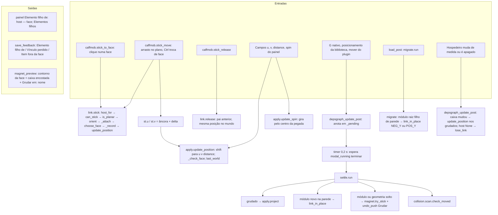

# Fluxograma: módulo `stick`

Grudar itens em faces planas (feature 004, I1) e prévia do ímã (feature 005). Vínculo = pai Blender + `Object.btm_stick`.

`frame.py` é puro: referencial `(origem, U, V, N)` da face no espaço local do hospedeiro, `BOX_SIDE` (acompanha medida)
ou `PLANE` (plano fixo). O item é descrito por `(u, v, distance)` = canto mínimo da pegada no referencial.
