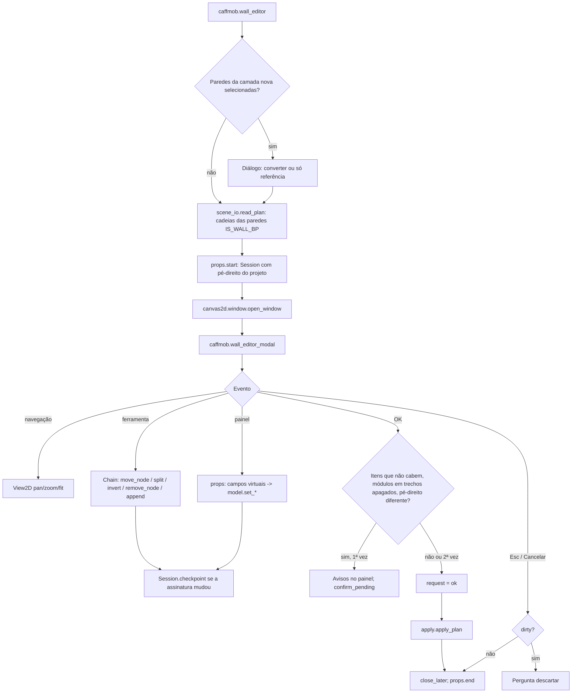
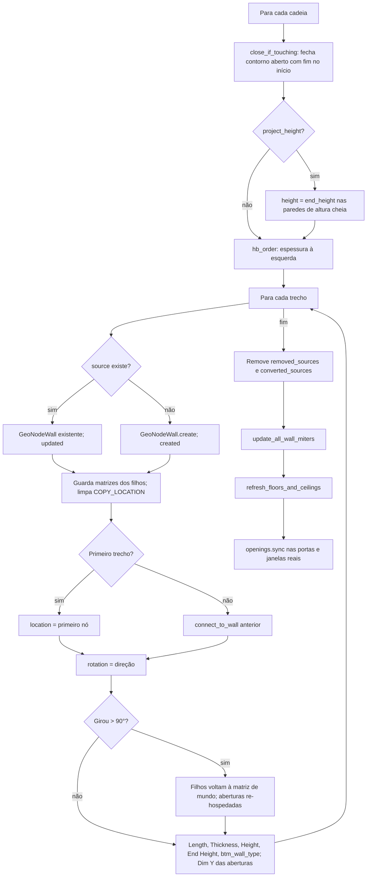
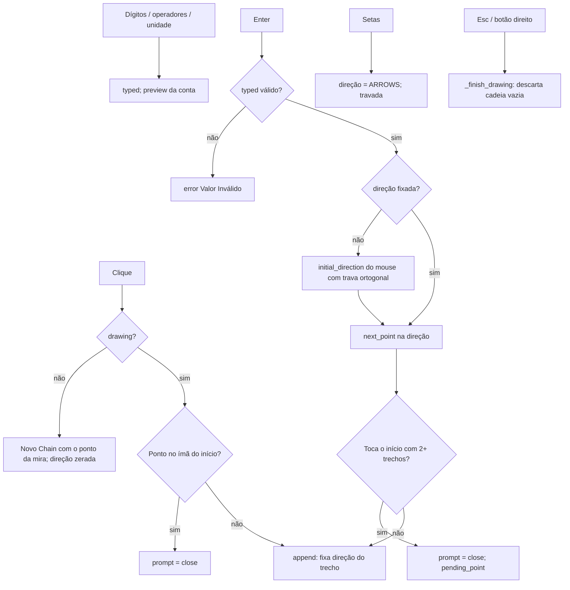

# Fluxograma do Módulo: walls2d

Editor de Paredes 2D (`caffmob_draw/walls2d/`), nível **Detalhado**. Re-extração 2026-10 (Fase 2c).

## 1. Ciclo abrir → editar → OK

## 2. `apply_plan`

## 3. Lápis (ferramenta Construir Parede)

