# Máquinas de Estado do Sistema — BlenderToMob

Este documento apresenta a especificação detalhada das máquinas de estado dos operadores modais e comportamentos dinâmicos do add-on **BlenderToMob**, conduzido pelo agente **Detective** no nível de documentação **Detalhado**.

---

## 1. Construtor de Parede Modal (`BTM_OT_WallBuilder`)

Esta máquina de estado gerencia a captura de coordenadas do cursor, buffer de entrada numérica via teclado e confirmação de segmentos polilinhas para geração geométrica final.

### 1.1 Diagrama de Estados (Mermaid)

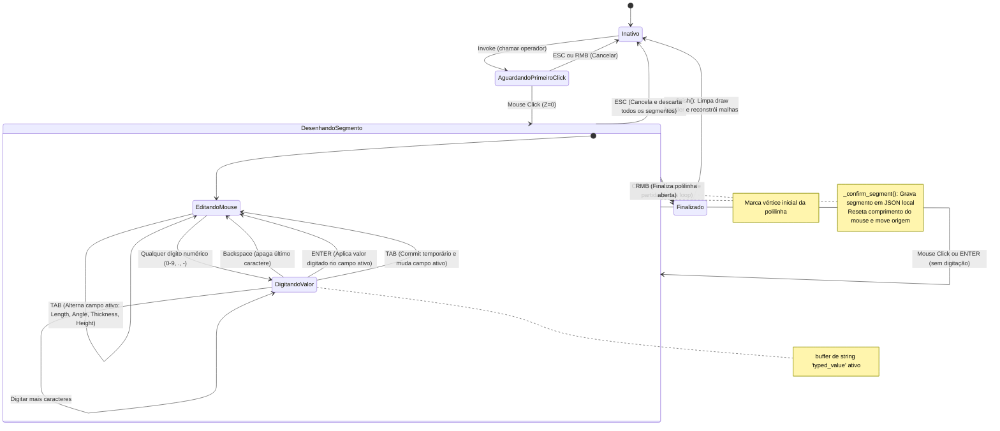

---

## 2. Inserção de Aberturas interativa (`BTM_OT_InsertOpening`)

Esta máquina de estado controla o arrasto de portas e janelas nas paredes da cena, aplicando lógica de snapping 2D e peitoril vertical.

### 2.1 Diagrama de Estados (Mermaid)

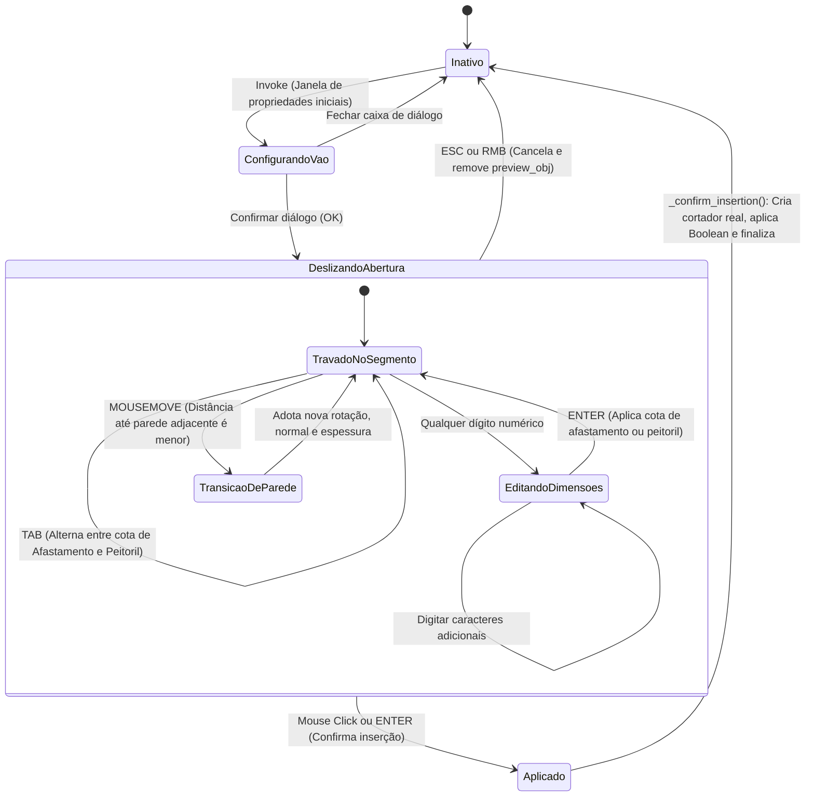

## Re-extração 2026-10-10 — estados atuais

Os diagramas anteriores descrevem operadores da base antiga. Os estados abaixo são abstrações documentais dos campos e eventos atuais, não novos enums persistidos. 🟢 Transições extraídas do código; runtime Blender não executado nesta análise.

### Editor de paredes

Fonte: `caffmob_draw/walls2d/ops_editor.py; props.py`.

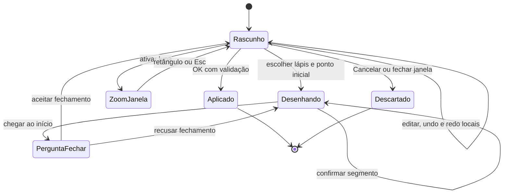

Zoom/pan não registram passo de undo nem reaplicam o snap. Esc tem significado contextual: zoom, buffer, desenho ou encerramento, conforme estado.

### Editor de armário

Fonte: `caffmob_draw/cabinet_editor/ops_editor.py; state.py`.

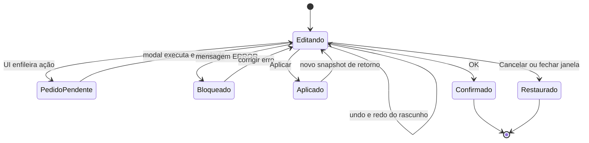

Cancelamento restaura o último ponto Aplicar, ou o inicial se nunca aplicou. WARNING não bloqueia; ERROR bloqueia Aplicar/OK.

### Inspeção de frentes

Fonte: `caffmob_draw/inspection/ops_inspect.py`.

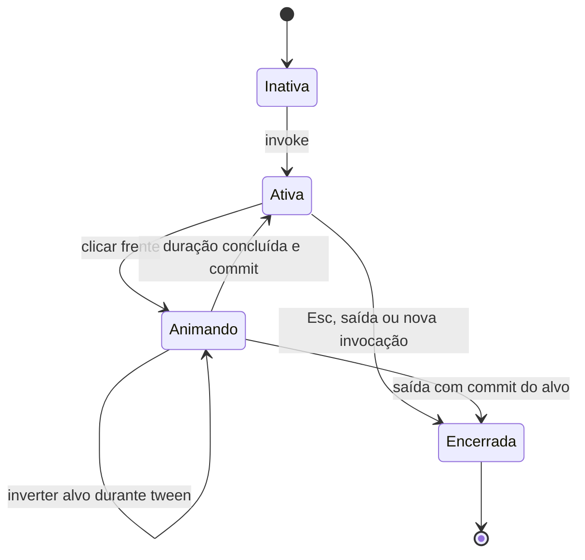

60 Hz, duração 0,35 s e smoothstep. Esc finaliza no alvo; não retorna automaticamente ao estado inicial. Unregister não percorre explicitamente os timers da sessão.

### Proteção de frentes ao salvar

Fonte: `caffmob_draw/inspection/save_guard.py`.

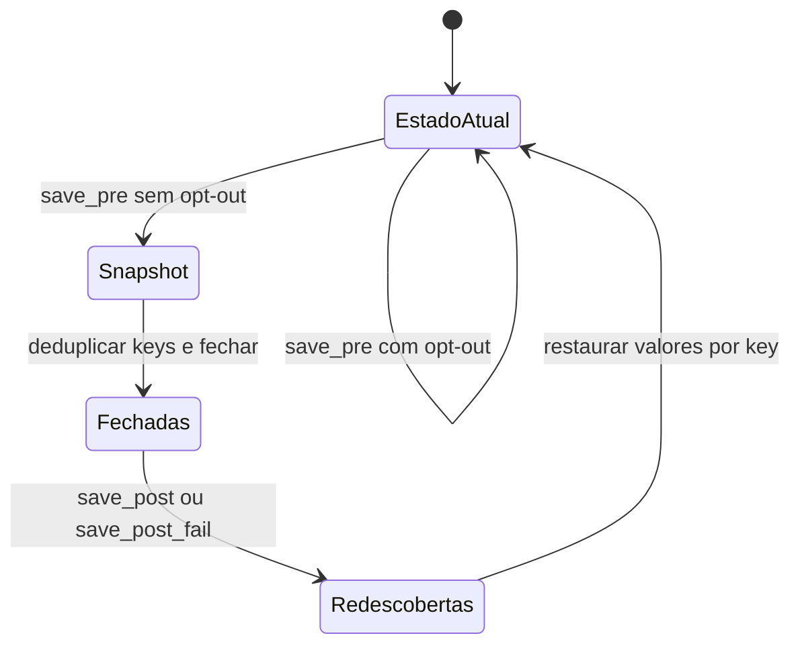

Snapshot efêmero por cena/key. Frente removida não é restaurada; animação e commit pendente podem interferir com o ciclo.

### Colisão de corpo

Fonte: `caffmob_draw/collision/ops_collision.py; stale.py`.

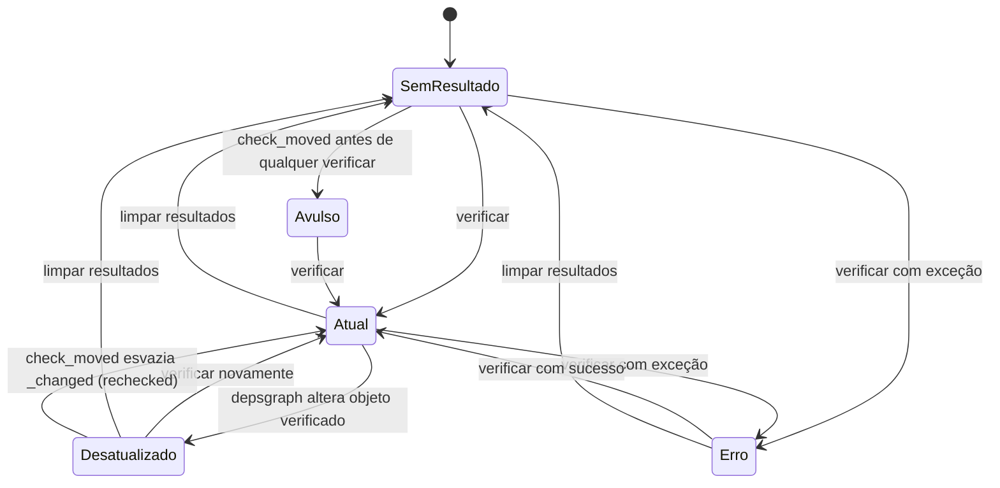

_(Revisão cruzada 2026-10-10: estados Avulso e Erro e a volta por `check_moved` acrescentados; collision/design.md › Máquina de Estados do Resultado, scan.py:check_all/check_moved, stale.py:rechecked)_ Avulso = `checked < 0` com linhas (collision EC-04): nunca fica desatualizado. Erro = `error != ""`; `check_moved` bem-sucedido não sai dele (collision EC-10).

A flag stale não reexecuta automaticamente a análise. A interferência de abertura em inspection usa outro armazenamento e não herda automaticamente esse contrato.

### Geometria livre

Fonte: `caffmob_draw/geometry_free/ops_create.py`.

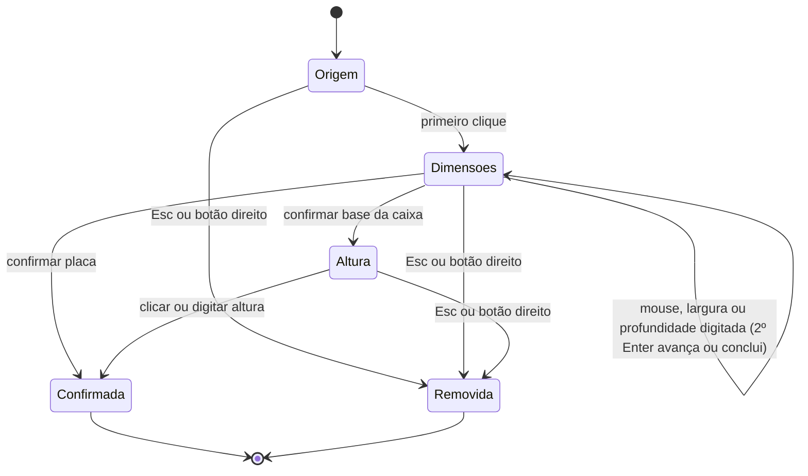

Objeto existe desde invoke. Dígitos digitados antes do primeiro clique ficam no buffer e valem no passo seguinte (geometry_free EC-05) _(Revisão cruzada 2026-10-10: geometry_free/design.md › Divergências; ops_create.py)_. Cancelamento externo não tem método cancel explícito; transição nessa condição é lacuna.

### Biblioteca lateral

Fonte: `caffmob_draw/library_panel/ops_click.py; draw.py`.

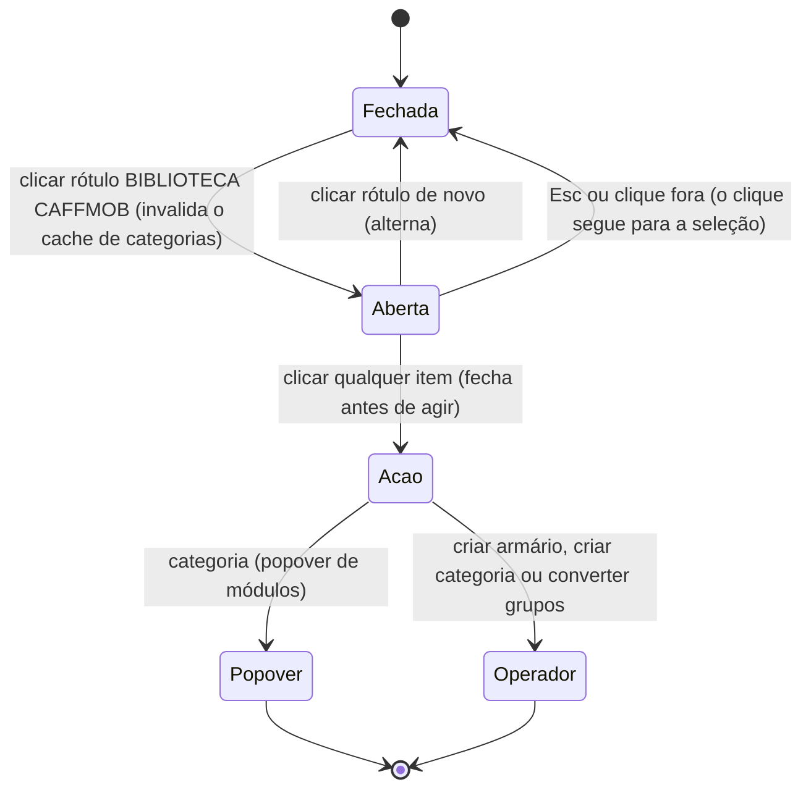

_(Revisão cruzada 2026-10-10: library_panel/ops_click.py:dispatch — `LABEL` alterna `state.open`; qualquer outro item faz `state.open = False` antes de agir; painel desenhado no topo da viewport, não na lateral; library_panel/design.md (a))_

Painel POST_PIXEL não usa modal permanente. Estado aberto global, não isolado por janela.

### Inserção de objeto da biblioteca

Fonte: `caffmob_draw/object_library/ops.py`.

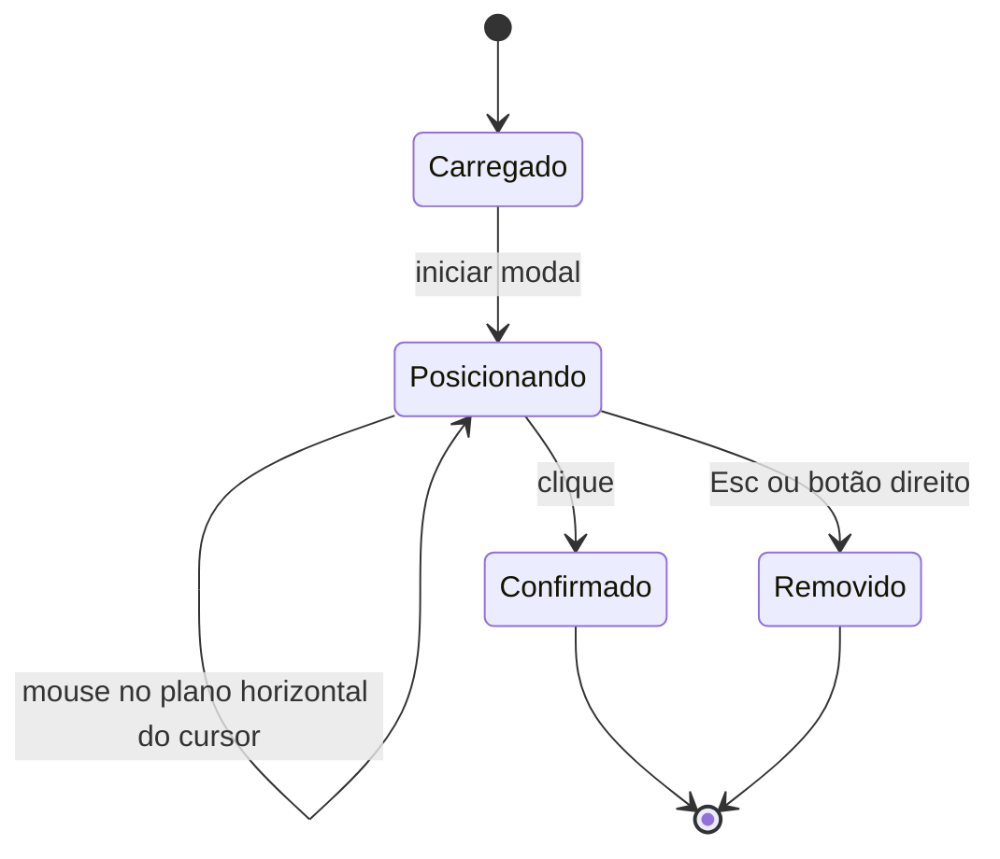

Cancel externo limpa somente cabeçalho no código observado; não inferir remoção do grupo nesse caminho.

### Vínculo do grudar

Fonte: `caffmob_draw/stick/apply.py; link.py; settle.py` (tabela completa em `_reversa_sdd/stick/design.md` › Máquina de Estados do Vínculo). _(Revisão cruzada 2026-10-10: máquina ausente deste documento; acrescentada a partir de stick/design.md)_

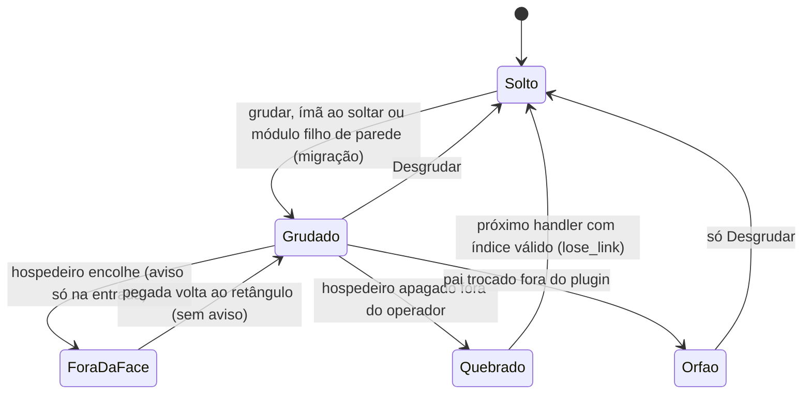

Órfão não tem saída automática e a colisão continua usando `btm_stick.host` como ligado (stick EC-02; collision `_links`). `btm_stick` é salvo no `.blend`.
